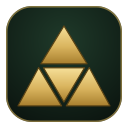

# Zelda 100% Tracker

A GTK4/libadwaita app for Linux that reads your save file from a Zelda game and
shows how close you are to 100%: an overall percentage, your hearts, and a checklist per
category. It works out which game a save belongs to by itself.

| Game | Platform | What's tracked |
|---|---|---|
| Majora's Mask 3D | 3DS | All 52 Pieces of Heart with step-by-step instructions, masks, songs, items, bottles, upgrades, Great Fairies, Spider Houses, bosses, owl statues |
| Ocarina of Time 3D | 3DS | All 36 Pieces of Heart with step-by-step instructions, all 100 Gold Skulltulas (Master Quest too), Skulltula House rewards, Heart Containers, stones and medallions, songs, items, equipment, upgrades, bottles |
| Link's Awakening DX | Game Boy Color | All 12 Pieces of Heart, Heart Containers, the 8 instruments, songs, items, upgrades, golden leaves and trading quest, hidden seashells, the photo album. Original Game Boy saves work too |
| Oracle of Seasons | Game Boy Color | Pieces of Heart, Heart Containers, essences, items, upgrades, the four seasons, all 64 rings |
| Oracle of Ages | Game Boy Color | Pieces of Heart, Heart Containers, essences, items, upgrades, harp tunes, all 64 rings |
| The Minish Cap | Game Boy Advance | Hearts, elements, items, upgrades, Tiger Scrolls, butterflies, bottles, all 136 figurines, Kinstone fusions |
| A Link Between Worlds | 3DS | Hearts, pendants, Ravio's items (owned vs. rented), nice items, other items, bottles |
| A Link to the Past | Super Nintendo | Pieces of Heart, Heart Containers, pendants, crystals, items, upgrades, bottles |
| Twilight Princess | GameCube | Hearts, Fused Shadows and Mirror Shards, items, equipment, all 24 Golden Bugs, Poe Souls, letters, bottles |

Not supported yet: A Link to the Past & Four Swords on GBA (only the SNES save is read),
Twilight Princess on Wii or HD (only GameCube .gci saves), Phantom Hourglass, Spirit Tracks
and Tri Force Heroes. Their save formats aren't documented well enough yet to read them
reliably.

## Run

    python3 zelda_tracker.py [path/to/save]

or `./install.sh` once to add it to your app launcher (and `zelda-tracker` to `~/.local/bin`).

- **Open** (Ctrl+O) a save, or drop one on the window.
  - 3DS: the slot files from Checkpoint/JKSM or Citra/Azahar/Lime3DS.
  - Game Boy / GBA / SNES: the `.sav` (or `.srm`) file your emulator writes next to the ROM.
  - GameCube: the `.gci` file Dolphin exports (Memory Card Manager → Export).
- Every file slot (or sibling slot file) shows up as a tab.
- Tap a category to open its checklist. **All / Missing** filters it.
- The window reloads by itself when the save changes, so you can keep it open next to an
  emulator. Ctrl+R reloads by hand.
- It remembers the last save you opened. On first run it looks in emulator folders and
  `~/Downloads`.

Needs only Python 3 with PyGObject, GTK 4 and libadwaita ≥ 1.7. It reads saves and never writes to them.

## Guides

Every section has instructions:

- Checks with a fixed location (heart pieces, dungeon items, songs, seashells, Golden Bugs and so on)
  expand into numbered steps. Item requirements come from the randomizers' logic where they exist
  (LADXR, oracles-randomizer-ng, Archipelago).
- Things the save only counts (Poe Souls, figurines, Kinstone fusions, rings, photos, total hearts)
  get a "How to get these" card at the top of their page.
- The guides live in `games/guides/<game>.py`. They were written from community sources and memory,
  so if a step is wrong, edit that file or open an issue.

## How sure is each game?

Everything is read straight from the save, using layouts from the community's
disassemblies, decompilations and randomizers:

- **MM3D:** Z3DR/mm3dr, 2Ship2Harkinian and the MM decomp, checked against real saves.
- **OoT3D:** the OoT3D Randomizer's SaveContext and location table.
- **Link's Awakening DX:** zladx/LADX-Disassembly for the save layout; LADXR and the
  Magpie/Archipelago autotracker for which room flag is which check.
- **Oracles:** Drenn1/oracles-disasm for the save layout and room flags.
- **Minish Cap:** zeldaret/tmc for the save layout.
- **A Link to the Past:** the community SRAM map; Archipelago's ALttP client for which
  flag is which location.
- **A Link Between Worlds:** Brionjv's open-source save editor. Only bytes the editor
  actually reads are used, so sword/mail levels, Maiamai and Sages are left out.
- **Twilight Princess:** zeldaret/tp for the save layout.

Some things the games simply don't store per location:

- **Oracles:** only some Pieces of Heart have a flag we can name (chests, Maple, the gasha
  tree, the shops). The rest are counted from your heart total and marked **Inferred**.
- **Minish Cap, A Link Between Worlds, Twilight Princess:** hearts are shown as a total
  (this tracker doesn't read per-location heart flags for them). Poe Souls (TP) are counted.
- **A Link to the Past:** 19 of the 24 Pieces of Heart are read by location; the other 5 are
  counted from your hearts and marked **Inferred**.
  Kinstone fusions and the photo album (LADX) are counted rather than named.
- **MM3D:** the Stock Pot Inn toilet hand's flag is wiped every cycle, so it's inferred
  from your hearts.

## Icons (optional, bring your own)

No game artwork ships with this app. To show your own icons, put them in
`icons/<game>/` next to `zelda_tracker.py` (git ignores this folder) or
`~/.local/share/zelda-tracker/icons/<game>/`. `<game>` is `mm3d`, `oot3d`, `ladx`, `oos`,
`ooa`, `tmc`, `albw`, `alttp` or `tp`. Name each file after the check id without its prefix: `i_hookshot` →
`icons/oot3d/hookshot.png`, `m_deku` → `icons/mm3d/deku.png`.

## App icon (optional)

`install.sh` uses `icons/app.png` as the launcher icon if that file exists (a 256×256 PNG with a
transparent background works best); otherwise it uses the bundled heart icon. Run `./install.sh`
again after changing it.

## Code layout

- `zelda_tracker.py` — the app window, shared by every game.
- `core.py` — the shared model: slots, sections and checklist rows.
- `games/` — one module per game; each detects its save format and reads it into sections.

## Disclaimer

A fan-made tool, not affiliated with or endorsed by Nintendo. The Legend of Zelda, the Triforce
and the game names are trademarks of Nintendo. No game code, assets or artwork ship with this app.
